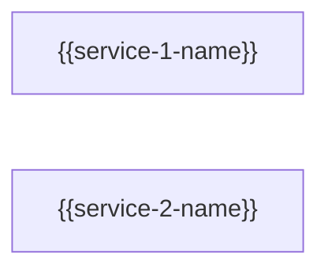

# Шаблон: обзор архитектуры ИС

Назначение шаблона: дать C4 level 1–2 картину ИС — компоненты, связи между
ними, внешние интеграции, потоки данных. Файл-экземпляр:
`architecture/overview.md`, ровно один на ИС.

## Фиксированные секции (порядок менять запрещено)

1. Таблица сервисов (обязательно)
2. Диаграмма компонентов (обязательно)
3. Внешние интеграции (обязательно)
4. Потоки данных (обязательно)

## Скелет файла

````markdown
# {{is-name}}: обзор архитектуры

## 1. Таблица сервисов

| Сервис | Тип | Репозиторий | Назначение |
|---|---|---|---|
| {{service-1-name}} | {{service-1-type}} | {{service-1-repo}} | {{service-1-purpose}} |

## 2. Диаграмма компонентов



## 3. Внешние интеграции

| Внешняя система | Направление | Протокол | Назначение |
|---|---|---|---|
| {{ext-1-name}} | {{ext-1-direction}} | {{ext-1-protocol}} | {{ext-1-purpose}} |

## 4. Потоки данных
{{data-flow-description}}

<!-- EXTENSIONS -->
<!-- Опциональные секции добавляются здесь и только здесь. Порядок фиксированных секций выше менять запрещено. -->
````

## Таблица слотов

| Слот | Источник факта | Формат | Лимит | Если факта нет |
|---|---|---|---|---|
| `{{service-1-name}}` | каталог в `services/` | kebab-case, совпадает с именем каталога | ≤ 40 символов | — (строка не создаётся без сервиса) |
| `{{service-1-type}}` | `service-overview.md` этого сервиса, поле «стек» | закрытый список: `fe` \| `be` \| `adapter` | закрытый список | `N/A (нет данных в источнике)` |
| `{{service-1-repo}}` | GitLab, путь ИС + имя репозитория | путь вида `ecom/dev/is/mm/erm/<repo>` | 1 строка | `N/A (нет данных в источнике)` |
| `{{service-1-purpose}}` | `service-overview.md` этого сервиса | 1 строка | ≤ 120 символов | `N/A (нет данных в источнике)` |
| диаграмма компонентов | таблица сервисов + связи из кода/контрактов | `mermaid flowchart LR`, узел на сервис | узлов = числу строк таблицы сервисов | если сервисов ещё нет — Mermaid-блок не создаётся, в секции остаётся текст `N/A (нет данных в источнике)` |
| `{{ext-1-name}}` / `{{ext-1-direction}}` / `{{ext-1-protocol}}` / `{{ext-1-purpose}}` | контракты в `services/*/contracts/`, Confluence-таблицы интеграций | направление — закрытый список: `inbound` \| `outbound` \| `bidirectional` | ≤ 120 символов на назначение | `N/A (нет данных в источнике)` |
| `{{data-flow-description}}` | код, ADR, диаграмма выше | 1–3 абзаца прозы | ≤ 800 символов | `N/A (нет данных в источнике)` |

## Самопроверка (чек-лист)

- [ ] Секции идут в порядке 1–4, ничего не переставлено.
- [ ] Front-matter содержит `id: architecture-overview`, `type: architecture-overview`.
- [ ] Каждый сервис в таблице существует как каталог `services/<svc>/`.
- [ ] `{{service-1-type}}` — только `fe`, `be` или `adapter`, ничего третьего.
- [ ] Диаграмма компонентов — единственный mermaid-блок в файле для этой секции.
- [ ] Файл не превышает 400 строк.
- [ ] Файл добавлен ровно в один `index.yaml`.

## Как используется скиллом

- check-id: DEP-01 (контекст)
- роль в проверке: обзор ИС показывает, какие сервисы и внешние интеграции затронуты, и тем самым определяет, для каких сервисов DEP-01 должен найти `service-overview`. Расхождение между задачей и обзором (задача трогает интеграцию, которой в обзоре нет) — вопрос до оценки, а не молчаливое расширение объёма.
